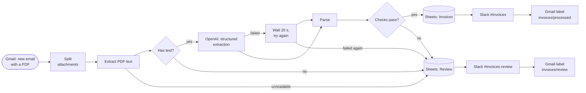
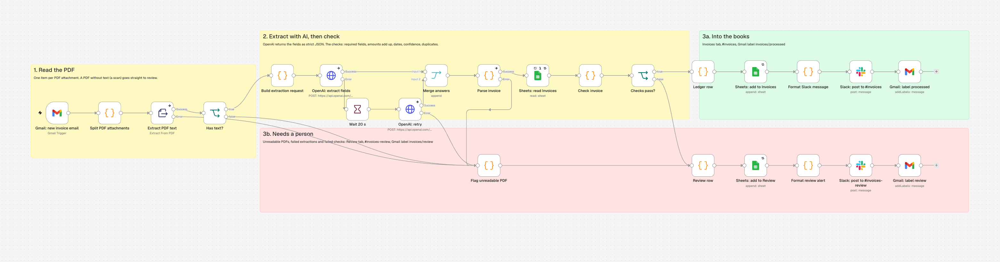
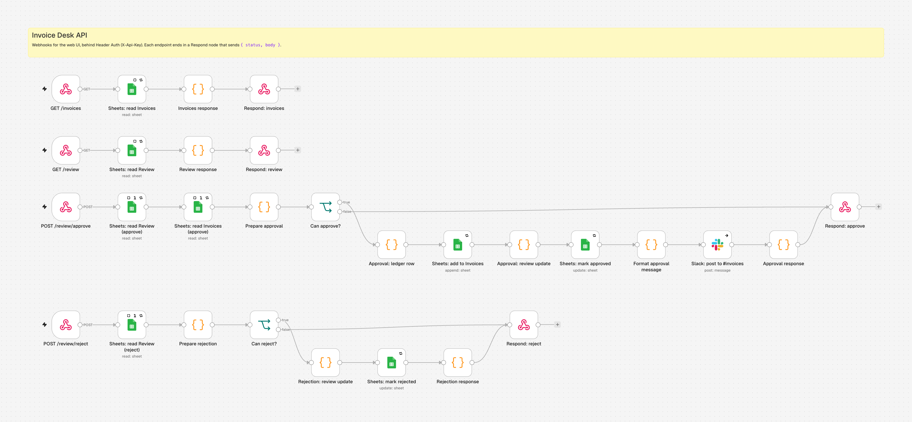

# AI Invoice Automation (n8n)

> **Invoices in, bookkeeping out.** An invoice arrives in Gmail, AI reads the PDF and extracts the supplier, amounts, dates and VAT, the row lands in Google Sheets and the team gets a Slack message. Anything the workflow is not sure about goes to a separate branch for manual review instead of into the books. **Invoice Desk**, a React dashboard, shows what came in and lets a person approve or fix the flagged ones.


## How it works



1. **Gmail trigger** polls for emails that match `INVOICE_GMAIL_QUERY` (PDF attachments not yet labelled), and downloads the attachments. A PDF uploaded in Invoice Desk enters the same way, through a webhook.
2. **Each PDF is handled on its own**, so an email with three invoices gives three rows, and one bad PDF doesn't hold up the others.
3. **The text is extracted from the PDF.** A PDF without text (a scan) or one that can't be opened goes straight to review.
4. **OpenAI** gets the text and a strict JSON schema. The answer is the invoice fields plus a confidence score, never free text. A failed call (rate limit, server error) is tried again after 20 seconds; if that fails too, the invoice goes to review.
5. **Checks** decide whether the result can go straight into the books (see below).
6. **Into the books**: a row is added to the **Invoices** tab, a short message is posted to `#invoices`, and the email is labelled `invoices/processed`.
7. **Needs a person**: the invoice goes to the **Review** tab with the reasons, `#invoices-review` gets an alert with links to the email and the sheet, and the email is labelled `invoices/review`. A person fixes it in Invoice Desk and approves it into the Invoices tab, or rejects it.
8. **Errors** in the workflow itself (expired credentials, Google Sheets or Slack down) start a separate error workflow that posts the failed step, the error and a link to the execution to `#invoices-review`, so it can be fixed and retried from n8n.



The workflows are [`workflows/invoice-processing.json`](workflows/invoice-processing.json) and [`workflows/invoice-errors.json`](workflows/invoice-errors.json). OpenAI is called through n8n's HTTP Request node with a strict JSON schema (`response_format: json_schema`), so every answer has exactly the fields above, with `null` for anything that isn't on the invoice.

### Extracted fields

| Field | Example | |
|---|---|---|
| `supplier_name` | ТОВ «Будмакс» | Legal name of the seller |
| `supplier_tax_id` | 41234567 | EDRPOU / VAT id, if printed |
| `invoice_number` | INV-2026-0142 | |
| `invoice_date` | 2026-11-03 | ISO date, whatever the format on the PDF |
| `due_date` | 2026-11-17 | Optional |
| `currency` | UAH | ISO 4217 |
| `net_amount` | 10000.00 | Total without VAT |
| `vat_rate` | 20 | Percent; `0` for VAT-exempt |
| `vat_amount` | 2000.00 | ПДВ |
| `total_amount` | 12000.00 | Amount due |
| `confidence` | 0.95 | The model's own estimate, 0–1 |

### When an invoice goes to manual review

Every reason that applies is listed in the Review tab, with a sentence a person can act on ("Amounts don't add up: net + VAT is 10 140,00, the total says 10 240,00").

| Reason | When |
|---|---|
| `missing_fields` | Supplier, invoice number, date, currency, net, VAT or total is missing, or a date can't be read |
| `amounts_mismatch` | `net + VAT ≠ total`, or `VAT ≠ net × rate` (2 cents of rounding allowed) |
| `invalid_date` | The invoice date is in the future, or the due date is before it |
| `low_confidence` | The model's confidence is below `INVOICE_MIN_CONFIDENCE` |
| `duplicate` | The same supplier (tax id, or name without one) and invoice number are already in the Invoices tab, or earlier in the same batch |
| `no_text_layer` | The PDF has no text, usually a scan |
| `extraction_failed` | The PDF can't be opened, or OpenAI failed twice |

## Test invoices

[`samples/invoices/`](samples/invoices) holds five PDF invoices, each covering one case. Email one to the inbox the workflow watches and compare the result with [`expected.json`](samples/invoices/expected.json), which lists the values the workflow should extract and where each invoice should end up.

| # | Invoice | Supplier | Total | Expected |
|---|---|---|---|---|
| 1 | [Ukrainian supplier, UAH, ПДВ 20%](samples/invoices/01-budmax-uah-vat-20.pdf), date written in words | ТОВ «Будмакс» | 12 000,00 UAH | Invoices tab |
| 2 | [EU supplier, EUR, VAT 19%](samples/invoices/02-nordlicht-eur-vat-19.pdf), German labels, date as `03.11.2026` | Nordlicht Bürotechnik GmbH | 1.873,06 € | Invoices tab |
| 3 | [VAT-exempt services (0%)](samples/invoices/03-kovalenko-uah-no-vat.pdf) from a sole proprietor | ФОП Коваленко О. І. | 23 400,00 UAH | Invoices tab |
| 4 | [Net + VAT doesn't match the total](samples/invoices/04-ofis-plus-amounts-mismatch.pdf): 8 450 + 1 690 ≠ 10 240 | ТОВ «Офіс Плюс» | 10 240,00 UAH | Review tab: amounts don't add up |
| 5 | [Scanned image, no text layer](samples/invoices/05-tekhnoservis-scanned.pdf) | ТОВ «ТехноСервіс Груп» | 9 000,00 UAH | Review tab: no text in the PDF |

The invoices are generated from [`scripts/src/data.ts`](scripts/src/data.ts), so they are easy to change or extend. The scan is a screenshot of the page, tilted and given scanner noise, saved as an image-only PDF. All companies, tax ids and bank details are made up.

```bash
cd scripts
npm install
npm run samples   # rebuild the PDFs and expected.json (needs Chrome; set CHROME if it isn't found)
npm test          # the PDFs and expected.json agree, and the workflow's code works; runs in CI
```

## Invoice Desk

The web UI reads the same Google Sheets tabs through the API below, so what it shows is always what is in the books.

- **Dashboard**: what was booked and how much VAT this month, how many invoices wait for review and why, invoice totals for the last six months, the top suppliers and the latest invoices. Amounts are never added across currencies; a switch picks which one to show.
- **Invoices**: the whole ledger in a table you can search (supplier, tax ID, invoice number, file, sender), filter by currency, sort and download as CSV, with the totals of what is on screen. Filters live in the URL, so a filtered view can be shared. Clicking a row opens the invoice: amounts and whether they add up, dates, the AI's confidence, where it came from and a link to the email in Gmail.
- **Review**: the invoices the checks held back, with the reasons. Fix the fields and see the checks pass or fail as you type (with one-click fixes when the right total or VAT follows from the other amounts), then approve the invoice into the books with a note for Slack, or reject it. n8n runs the same checks again before booking it. Approved and rejected items stay listed with the decision.
- **Upload PDF**: drop one or more PDFs into the app instead of emailing them. Each goes through exactly the same steps as an emailed invoice.
- **How it works**: the five steps an invoice goes through.

On a laptop or desktop every page fits the window; long lists scroll inside their panel. On a phone the pages scroll as usual.

## Tech stack

| | |
|---|---|
| **Automation** | n8n 2.46 (self-hosted, Docker Compose) |
| **AI** | OpenAI, structured output with a JSON schema |
| **Integrations** | Gmail (trigger, labels), Google Sheets (ledger), Slack (notifications) |
| **Web UI** | React 19, TypeScript (strict), Vite, Material UI 9 (light and dark), MUI X Charts, TanStack Query, React Router |
| **API** | n8n webhook workflow behind Header Auth; nginx (Docker) and Vite (dev) proxy `/api/*` to n8n's `/webhook/*` and add the key |
| **Tests** | The workflows' Code nodes run in Vitest against the test invoices' expected values; the test PDFs are printed by headless Chrome, the scan made with sharp and pdf-lib, and checked with pdf.js (unpdf) |
| **Quality** | Vitest + Testing Library, oxlint, Prettier, pre-commit, GitHub Actions |

## Quick start

Requires Docker with Compose.

```bash
cp .env.example .env      # workflow settings (sheet id, channels, model)
docker compose up -d --build
```

| | |
|---|---|
| **Invoice Desk** (web UI) | http://localhost:8080 |
| **n8n** (workflow editor) | http://localhost:5678 |

Open n8n and create the owner account. Then:

1. **Credentials** (in n8n: *Credentials → Add credential*):
   - **Gmail** and **Google Sheets**: Google OAuth2. In Google Cloud, enable the Gmail and Sheets APIs and add `http://localhost:5678/rest/oauth2-credential/callback` as a redirect URI.
   - **OpenAI**: an API key.
   - **Slack**: a bot token with the `chat:write` scope, invited to both channels.
   - **Invoice API key**: *Header Auth*, name `X-Api-Key`, value the same as `INVOICE_API_KEY` in `.env` (`openssl rand -hex 24`).
2. **Google Sheet** with two tabs, **Invoices** and **Review**. Put its id in `INVOICE_SHEET_ID`. The workflow fills columns by name, so paste these header rows into row 1 of each tab.

   **Invoices**:
   ```
   received_at	supplier_name	supplier_tax_id	invoice_number	invoice_date	due_date	currency	net_amount	vat_rate	vat_amount	total_amount	confidence	file_name	email_from	email_subject	email_link	gmail_message_id
   ```
   **Review** (the reasons, the same columns, then where the review stands):
   ```
   review_reasons	review_details	received_at	supplier_name	supplier_tax_id	invoice_number	invoice_date	due_date	currency	net_amount	vat_rate	vat_amount	total_amount	confidence	file_name	email_from	email_subject	email_link	gmail_message_id	status	resolved_at	resolution_note
   ```
3. **Gmail labels**: create `invoices/processed` and `invoices/review` in Gmail (a label `invoices` with two nested labels).
4. **Import the workflows** from the terminal. This keeps their ids, so the others already point at the error workflow:
   ```bash
   docker compose exec n8n n8n import:workflow --input=/workflows/invoice-errors.json
   docker compose exec n8n n8n import:workflow --input=/workflows/invoice-processing.json
   docker compose exec n8n n8n import:workflow --input=/workflows/invoice-api.json
   ```
   (Importing in the editor works too, via *Workflows → Import from file*; then choose **Invoice processing errors** under *Settings → Error workflow* of the other two.)
5. **Finish the setup in the editor**: pick the credentials in each node (the webhooks use **Invoice API key**), and in **Gmail: label processed** and **Gmail: label review** pick the matching label. Activate all three workflows, then email yourself one of the test invoices, or upload one in Invoice Desk.

n8n's data (workflows, encrypted credentials, executions) is kept in the `n8n_data` volume. `docker compose down -v` deletes it.

### Developing the web UI

Requires Node 20.19+. With n8n running (`docker compose up -d n8n`):

```bash
cd client
npm install
npm run dev               # http://localhost:5173, proxies /api to n8n on :5678
```

| | |
|---|---|
| `npm test` | Unit and component tests (Vitest) |
| `npm run lint` | oxlint |
| `npm run typecheck` | TypeScript |
| `npm run format` | Prettier |
| `npm run build` | Production build into `dist/` |

`VITE_N8N_TARGET` points the dev proxy at another n8n. Optional git hooks: `pre-commit install`.

## API

The web UI talks to n8n through these webhooks (workflow [`invoice-api.json`](workflows/invoice-api.json), and the upload trigger in the main workflow).


 nginx serves them at `/api/*` and adds the `X-Api-Key` header, so the key never reaches the browser. Calling n8n directly without the key gets `403`.

| Endpoint | | Answers |
|---|---|---|
| `GET /api/invoices` | The Invoices tab, newest first | `{ invoices: Invoice[] }` |
| `GET /api/review?status=open` | The review queue: `open` (default), `approved`, `rejected` or `all` | `{ items: ReviewItem[] }` |
| `POST /api/review/approve` | `{ id, fields?, note? }`: apply the corrections, check them, move the invoice into the books, mark the review row approved, post to Slack | `{ invoice }`; `422 { message, problems }` if it still fails a check |
| `POST /api/review/reject` | `{ id, note? }`: mark the review row rejected | `{ id, status, resolved_at }` |
| `POST /api/upload` | One PDF as the multipart field `file`, processed exactly like an emailed one | `202 { status: "processing", file_name }` |

An item's `id` is its row number in the sheet. Errors are `{ message }` with `400` (bad request), `404` (no such item), `409` (already approved or rejected), `413` (over 10 MB) or `415` (not a PDF). An approval runs the same checks as the workflow, apart from the AI's confidence: required fields, valid dates and currency, amounts that add up, and no duplicate in the books.

```bash
curl -H "X-Api-Key: $INVOICE_API_KEY" localhost:5678/webhook/review
curl -X POST localhost:8080/api/review/approve -H "Content-Type: application/json" \
  -d '{"id": 4, "fields": {"total_amount": 10140}, "note": "Confirmed with the supplier"}'
curl -F file=@samples/invoices/02-nordlicht-eur-vat-19.pdf localhost:8080/api/upload
```

## Configuration

Set in `.env` (see [`.env.example`](.env.example)). Credentials are never stored here, only in n8n.

| Variable | Default | |
|---|---|---|
| `N8N_ENCRYPTION_KEY` | generated | Encrypts stored credentials. Set it to move or back up the data |
| `N8N_PORT` | `5678` | Port of the n8n editor |
| `INVOICE_WEB_PORT` | `8080` | Port of the web UI |
| `INVOICE_API_KEY` | — | Shared secret between the web UI's proxy and the API webhooks |
| `GENERIC_TIMEZONE`, `TZ` | `Europe/Kyiv` | Time zone for dates |
| `INVOICE_GMAIL_QUERY` | PDFs without an `invoices/*` label | Which emails are invoices |
| `INVOICE_SHEET_ID` | — | Google Sheet with the Invoices and Review tabs |
| `INVOICE_OPENAI_MODEL` | `gpt-5-mini` | Model used for extraction |
| `INVOICE_MIN_CONFIDENCE` | `0.8` | Below this, an invoice goes to review |
| `INVOICE_SLACK_CHANNEL` | `#invoices` | Processed invoices |
| `INVOICE_SLACK_REVIEW_CHANNEL` | `#invoices-review` | Invoices that need a person |

## Project layout

```
.
├── client/                 # Invoice Desk: React + Material UI
│   ├── src/
│   │   ├── api/            # typed fetch client for the n8n webhooks
│   │   ├── app/            # router, query client, MUI theme
│   │   ├── components/     # layout (sidebar, header, footer) and shared UI
│   │   ├── features/       # one folder per page: components, hooks, pages
│   │   ├── hooks/          # app-wide data hooks (n8n health, invoices, review queue)
│   │   ├── utils/          # formatting, invoice totals, filters, CSV, review checks
│   │   ├── constants/      # links, navigation, query keys, review reasons
│   │   ├── styled/         # shared sx styles
│   │   └── test/           # test setup and helpers
│   ├── Dockerfile          # Vite build served by nginx
│   └── nginx.conf          # SPA + /api proxy to n8n
├── workflows/              # exported n8n workflows (JSON, no credentials)
│   ├── invoice-processing.json  # Gmail or upload → AI → checks → Sheets, Slack
│   ├── invoice-api.json         # webhooks for the web UI
│   └── invoice-errors.json      # Slack alert when a workflow fails
├── samples/invoices/       # five test invoices (PDF) and expected.json
├── scripts/                # TypeScript: test invoices and tests for the workflows
├── docs/screenshots/       # screenshots for this README
├── docker-compose.yml      # n8n on :5678, web UI on :8080
├── .env.example            # workflow settings
├── .pre-commit-config.yaml
└── .github/workflows/ci.yml
```

## Roadmap

Built in small, reviewable pull requests:

- [x] **1. Project setup**: n8n and the web UI in Docker Compose, React + MUI app shell (layout, theme, routing, n8n status), tests, CI, pre-commit
- [ ] **2. Test invoices**: five PDF invoices covering the cases above, with expected values
- [ ] **3. Main workflow**: Gmail → PDF text → OpenAI extraction → Google Sheets → Slack
- [ ] **4. Review and errors**: checks, Review tab, Slack alerts, Gmail labels, error workflow
- [ ] **5. Workflow API**: n8n webhooks for the UI (invoices, review queue, approve/reject, upload)
- [ ] **6. Dashboard and invoices**: stats, charts, invoice table with details and the PDF
- [ ] **7. Review queue and upload**: fix and approve flagged invoices, upload a PDF by hand
- [ ] **8. Polish**: screenshots, end-to-end run on the test invoices, docs
